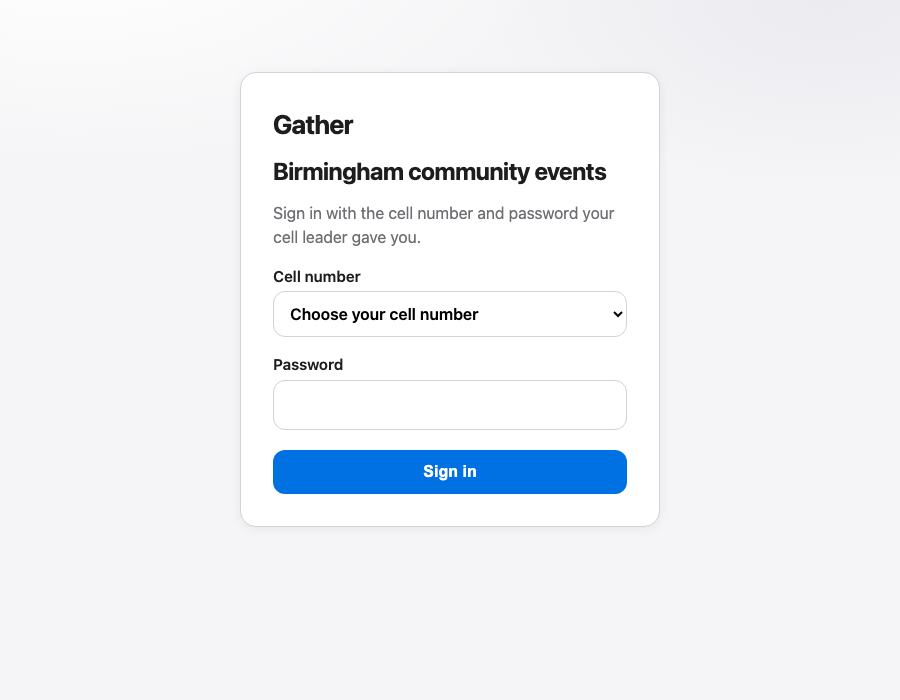

# Gather — Birmingham Community Events



A closed calendar for one community in Birmingham. An admin creates accounts from a file. Members sign in with a **cell number** (letters and digits; several people may share one) and a **password** (any length, must not be blank, **unique** per person so login can tell them apart), browse events, click Attend, and later confirm they went. Cell leaders review scraped events and look after their own cell.

**Live demo (Railway — keep until Ubuntu gate is green):** https://commseventsv1-production.up.railway.app

**Target hosting:** Oracle Always Free Ubuntu + Caddy + SQLite. Full gate checklist and install: [`docs/deploy-ubuntu.md`](docs/deploy-ubuntu.md). Do **not** turn Railway off or tell testers a new URL until that gate is all ticked.

This deployment is Birmingham only. Another region would be a separate copy with its own database, admin, and calendar.

## Presentation (stakeholders)

Day-of talk uses Guillaume/Rebecca **Canva** (tech, non-tutorial). An’s pack:

- [`docs/presentation/CANVA-TECH-BRIEF.md`](docs/presentation/CANVA-TECH-BRIEF.md) — colours + slide beats  
- [`docs/presentation/requirements-loop.md`](docs/presentation/requirements-loop.md) — requirements flow + GitHub  
- [`docs/presentation/STAKEHOLDER-CHECKLIST.md`](docs/presentation/STAKEHOLDER-CHECKLIST.md) — human owners  
- `npm run deck:stakeholder` → `docs/presentation/Gather-stakeholder.pptx`

Member tester guide (separate): [`docs/presentation/Gather-tester-guide.pptx`](docs/presentation/Gather-tester-guide.pptx) (`npm run deck`).

## Prerequisites

- Node.js 20 or later
- npm

Database is **SQLite** (one file on disk). No Postgres required for local or Ubuntu.

## Environment

Copy `.env.example` to `.env`.

| Variable | Purpose |
| --- | --- |
| `DATABASE_URL` | SQLite path relative to `prisma/`, e.g. `file:./data/gather.db` → `prisma/data/gather.db`. |
| `SESSION_SECRET` | Signs the httpOnly session cookie. Use a long random string. |
| `CRON_SECRET` | Guards `POST /api/cron/scrape`. |
| `APP_ORIGIN` | Exact origin for mutation checks, e.g. `http://localhost:3000` or your public HTTPS URL (no trailing slash). |
| `SCRAPE_LIVE` | Set to `0` to skip fetching Priority URLs. Fixtures still run unless `SCRAPE_FIXTURES=0`. |
| `SCRAPE_FIXTURES` | Set to `0` to skip the demo harvest. Default is on. |

## Setup

```bash
npm install
mkdir -p prisma/data
npx prisma db push
npm run db:seed
npm run dev
```

Open http://localhost:3000. The seed command prints cell numbers and initial passwords once to stdout. They are not shown in the app. Re-running seed is a no-op if the admin user already exists.

## Tests

```bash
npm test              # unit tests (integration tests run when TEST_DATABASE_URL is set)
npm run test:coverage
npm run typecheck
```

CI (`.github/workflows/ci.yml`) on push to `experiment` or `main`: typecheck, tests against SQLite, then `next build`.

What the app does, with who agreed it: [`docs/FUNCTIONAL.md`](docs/FUNCTIONAL.md). Weak points and the live smoke list: [`docs/REVIEW.md`](docs/REVIEW.md). What each demo build shipped: [`docs/CHANGELOG.md`](docs/CHANGELOG.md). Agent briefing (commands, always/ask/never): [`AGENTS.md`](AGENTS.md). Emil Kowalski UI/motion skills (how to invoke): [`docs/EMIL-SKILLS.md`](docs/EMIL-SKILLS.md). Ubuntu cutover: [`docs/deploy-ubuntu.md`](docs/deploy-ubuntu.md). Incident card: [`docs/incident-card.md`](docs/incident-card.md).

To start again:

```bash
npm run db:reset
```

## Migrations

```bash
mkdir -p prisma/data
npx prisma db push
```

That keeps the SQLite file in line with `prisma/schema.prisma`.

## Railway (legacy live demo)

The **current** live site still runs the last Postgres deploy on Railway. Do **not** push a SQLite-only `experiment` build to Railway until Ubuntu is ready (or redeploys are paused) — a Postgres `DATABASE_URL` with a SQLite schema will fail start (`scripts/start.sh` refuses Postgres URLs). See [`docs/deploy-ubuntu.md`](docs/deploy-ubuntu.md).

## Ubuntu / Oracle

Follow [`docs/deploy-ubuntu.md`](docs/deploy-ubuntu.md): Node 22, SQLite file, systemd, Caddy/TLS, cron scrape, dual backup of `gather.db`. Prefer `./scripts/install-ubuntu.sh`.

## Daily scraper (05:00 Europe/London)

Do not start a scheduler inside `next dev`. Use cron on the host:

```cron
0 5 * * * /path/to/app/scripts/scrape-cron.sh
```

`npm run scrape` and `POST /api/cron/scrape` with `Authorization: Bearer <CRON_SECRET>` both run the scraper with trigger `SCHEDULED`. The admin **Run now** button uses trigger `MANUAL` and an admin session.

The demo harvest runs unless `SCRAPE_FIXTURES=0`. If Priority URLs are set, Gather fetches only https ICS or JSON-LD from the host allowlist (User-Agent `GatherBirmingham/1.0`, robots.txt, 8s timeout, 1 request/s, 512 KiB body cap). Set `SCRAPE_LIVE=0` to skip the network. A failed feed is recorded on the run and does not stop the others. Saving an event after publish freezes scrape updates for that row. Gather does not collect member data from third-party sites.

## Import columns

Name, Cell number, Cell, Password, Permission.

Permission is `admin`, `cell leader`, or `member`. Cell number is letters and digits only (any length; can be shared). Password must be non-empty (any length) and unique across people. CSV, Excel, and JSON are accepted. If any row fails, nobody is created.

## Replacing a password

An admin opens **Members**, edits the person, types a new password, and tells the cell leader. The old password cannot be read back.

## What this build does not do

- Public registration or invites
- Member password reset
- Email or SMS
- A live link to the wider Birmingham department system
- Overlap warnings
- Attendance reminders
- A second city in this calendar
- Live HTML scraping of third-party pages (ICS/JSON-LD only)
- Weeks past the 12th occurrence of a series
- A hierarchy manager
