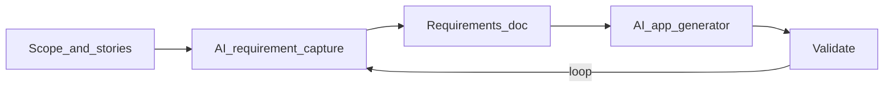

# Requirements loop (stakeholder diagram)

How Gather was scoped and generated. Screenshot this into Canva or use the matching slide from `npm run deck:stakeholder`.

**GitHub:** https://github.com/ai-xps/comms_events_v1  
**Live demo:** https://commseventsv1-production.up.railway.app

1. **Scope and user stories** — what the community needs (closed calendar, roles, scrape, Attend).
2. **AI requirement capture** — turn scope into structured requirements.
3. **Requirements doc** — the written contract the team can check.
4. **AI app generator** — build the Gather app from that doc (code on GitHub).
5. **Validate** — try the product; feed gaps back into capture (the loop).
